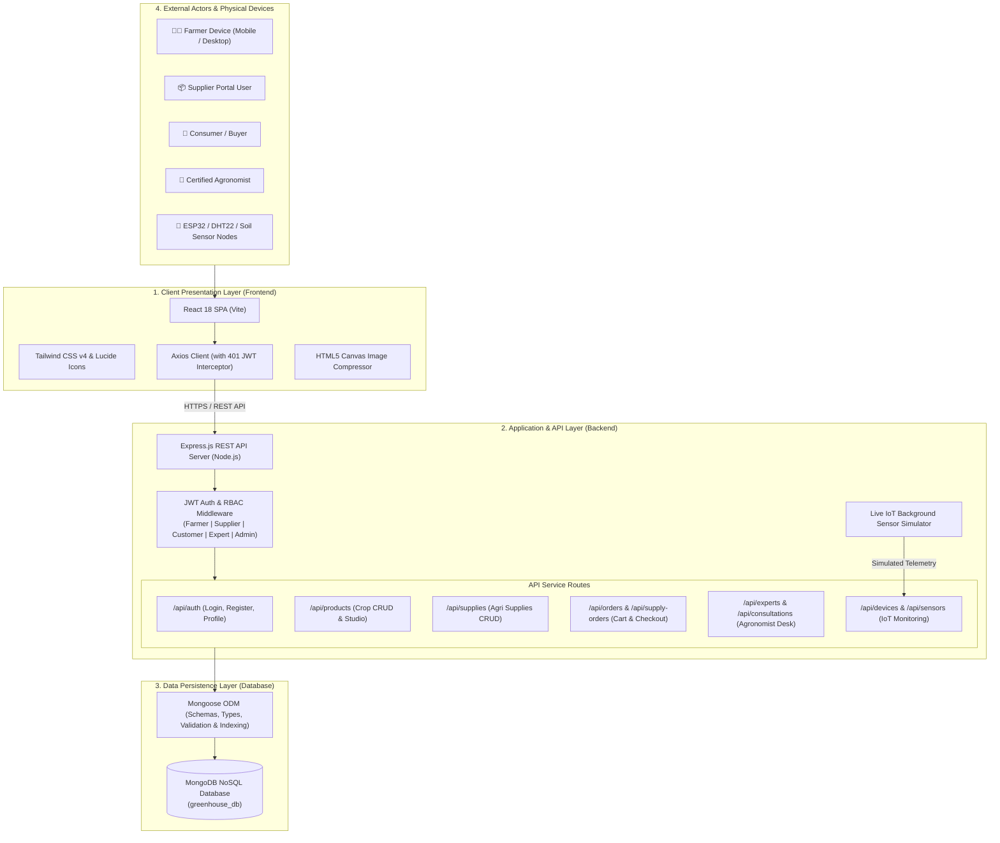
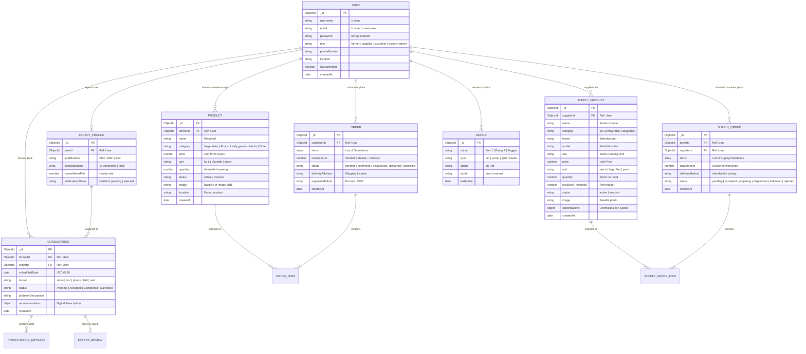

# SmartGrow — Greenhouse Management & Agricultural Marketplaces

SmartGrow OS is a full-stack greenhouse automation, hydroponic telemetry, and dual agricultural marketplace platform built with **React + Vite + Tailwind CSS v4** on the frontend and **Node.js + Express + MongoDB (Mongoose)** on the backend.

---

## Core Modules

1. **Smart Greenhouse Module** — Real-time environmental monitoring, climate zone control, and automated actuator management.
2. **Crop Marketplace** — Direct farmer-to-customer fresh harvest marketplace with shopping cart, checkout, order history, and farmer fulfilment portal.
3. **Agricultural Suppliers Marketplace (B2B & Farmer Input Exchange)** — Complete e-commerce and inventory management platform for agricultural supplies across 10 configurable categories:
   - Seeds
   - Fertilizers
   - Crop Protection Products
   - Irrigation Equipment
   - Greenhouse Equipment
   - Smart Farming Devices
   - IoT Components
   - Farming Tools
   - Growing Supplies
   - Hydroponic Equipment
4. **SmartGrow ExpertConnect (Greenhouse Agricultural Consultation Platform)** — Professional consultation ecosystem connecting protected-culture farmers and hydroponic growers with certified agronomists, plant pathologists, and automation engineers.

---

## SmartGrow ExpertConnect Platform Features

### 1. Verified Expert Directory (`/api/experts`)
- Filter and search verified specialists by name, qualification (`PhD`, `MSc`, `BSc`), 14 agricultural specializations, consultation format, availability, and fee range.
- Real-time status badges, experience metrics, verified qualification cards, and modal deep-dives.

### 2. Expert Application & Administrator Verification (`/api/experts/apply`, `/api/experts/admin/applications`)
- Credentialed professionals apply with educational background, field experience, bio, and certificates.
- Administrators review, verify, approve, or reject applicants (`403 Forbidden` guard against unauthorized self-verification).

### 3. Greenhouse Problem Diagnostic Intake & Rule-Based Matching (`/api/problems`)
- Farmers describe symptoms, crop growth stages, environmental/telemetry readings (temperature, RH, VPD, EC, pH), and upload up to 5 photographs ($\le 2\text{ MB}$, JPEG/PNG/WebP).
- Automatic rule-based expert recommendation engine transparently matches relevant specialists based on domain tags and experience.

### 4. Appointment Booking & Conflict Prevention (`/api/consultations`)
- Calendar scheduling in Sri Lanka Standard Time (`UTC+5:30`) across 4 formats: **Video**, **Text Advisory**, **Phone Call**, and **Field Visit**.
- Server-side slot collision detection returning `409 Conflict` on overlapping bookings.
- Strict cross-farmer and cross-expert access controls (`403 Forbidden`).

### 5. Private Participant Messaging Thread (`/api/consultations/:id/messages`)
- Chronological in-consultation chat with role badges (**Verified Expert** vs. **Farmer**), high-priority diagnostic notes, and photo uploads ($\le 2\text{ MB}$).

### 6. Structured Expert Recommendations & History (`/api/consultations/:id/recommendation`)
- Assigned experts record observations, probable root causes, step-by-step treatment plans, preventive practices, and chemical safety precautions.
- Permanent preservation in farmer's consultation history with Section 19 Agricultural Advice Responsibility Notice.

### 7. Genuine Reviews & In-App Notifications (`/api/consultations/:id/review`, `/api/consultations/notifications`)
- Only farmers with completed consultations can review specialists (self-reviews and duplicate reviews blocked).
- Live notification drawer keeping users alerted about appointment bookings, chat messages, approvals, and reviews.

### 8. Platform Governance & Moderation (`/api/admin/expertconnect`)
- High-level platform analytics (throughput, lifecycle statuses, top problem categories).
- Full consultation search ledger, review moderation/removal, and account suspension controls.

---

## Agricultural Suppliers Marketplace Features

### Customer & Farmer Storefront
- **Live MongoDB Catalog (`/api/supplies`)** with dynamic category, supplier, brand, availability, and min/max price range filtering.
- **Deep Technical & Composition Search** across product names, brands, models, SKUs, chemical formulas (`NPK`, `EC`, `pH`), and communication protocols (`RS485`, `LoRaWAN`, `Wi-Fi MQTT`).
- **Order-Backed Best-Selling Ranking** computed directly from real `SupplyOrder` records in MongoDB without fabricated reviews or ratings.
- **Dedicated Product Datasheet Modal** displaying electrical/IoT specifications, chemical composition, safety precautions, warranty, and delivery options.
- **Server-Verified Supplies Basket (`/api/cart/calculate-supplies`)** that recalculates unit prices, supplier subtotals, and delivery fees from trusted database records.
- **Atomic Checkout & Order Tracking (`/api/supply-orders`)** supporting Islandwide Delivery (`Cash on Delivery`) and Warehouse Pickup (`Pay on Collection`), duplicate submission protection, and customer order cancellation with automatic stock restoration.
- **Customer Account Profile (`/api/auth/profile`)** for managing permitted contact and default farm delivery details without exposing passwords or tokens.

### Authorized Supplier Portal (`role: 'supplier'`)
- **8-Card Live KPI Dashboard** tracking Total Listed Supplies, Active Listings, Low-Stock Alerts, Out-of-Stock Items, Pending Orders, Active Fulfilment, Completed Orders, and Verified Delivered Revenue ($).
- **Full Product & Specification Studio** to create, edit, toggle visibility, and delete supply products with strict supplier ownership verification.
- **Real-Time Inline Inventory Controls** (`-1`, `+1`, `+10`, `Set Exact Qty & Alert Threshold`, `Mark Out of Stock`) with automatic low-stock alert banners.
- **Supplier Order Fulfilment Workflow** supporting status transitions (`Pending` $\rightarrow$ `Accepted` $\rightarrow$ `Preparing` $\rightarrow$ `Ready for Dispatch` $\rightarrow$ `Dispatched` $\rightarrow$ `Delivered`, or `Rejected` with automatic warehouse stock restoration).

---

## Quick Start & Local Development

### 1. Backend Setup (`backend/`)
```bash
cd backend
npm install
```
Create a `.env` file in `backend/` with:
```env
MONGO_URI=your_mongodb_connection_string
JWT_SECRET=your_jwt_secret
PORT=5001
```
Seed initial supply catalog and verified agricultural experts (safe and idempotent):
```bash
node utils/seedSupplies.js
node utils/seedExperts.js
```
Start the backend server:
```bash
npm run dev
```

### 2. Frontend Setup (`frontend/`)
```bash
cd frontend
npm install
npm run dev
```
Production build verification:
```bash
npm run build
```

---

## Seeded Demo Accounts (for Testing & Grading)
- **Platform Administrator:** `admin@smartgrow.lk` / `admin123`
- **Verified Expert (Hydroponics & Automation):** `kavinda.expert@smartgrow.lk` / `expert123` (*Dr. Kavinda Perera, PhD*)
- **Verified Expert (Pathology & Diseases):** `tharushi.expert@smartgrow.lk` / `expert123` (*Dr. Tharushi Alwis, PhD*)
- **Verified Expert (Nutrient Management):** `roshan.expert@smartgrow.lk` / `expert123` (*Eng. Roshan Gunasekara, MSc*)
- **Verified Expert (Protected Agriculture):** `nadeesha.expert@smartgrow.lk` / `expert123` (*Nadeesha Wickramasinghe, MSc*)
- **Hardware & IoT Supplier / Farmer:** `supplier@smartgrow.lk` / `supplier123` (*SmartGrow Automation Supplies*)
---

## System Architecture & Technologies



---

## Database Design & Entity-Relationship Diagram (ERD)



